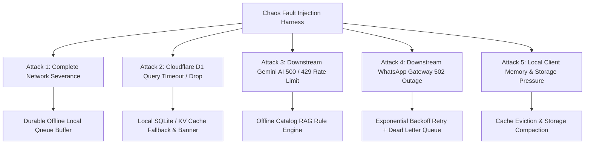

# 🌪️ OmniBuild OS™ — Chaos Engineering & Fault-Tolerance Test Plan (#22)
**Flagship System:** Godrej Interio Rayagada | Shree Ganesh Enterprises (`https://srivinayakafurnitures.pages.dev/`)  
**Target Architecture:** React 19 Frontend + Cloudflare Sovereign Edge D1 SQL + Gemini Multi-Lingual AI Concierge + WhatsApp Evolution Gateway  
**Author:** QA & Reliability Engineering Team  
**Standard Compliance:** Principles of Chaos Engineering (Netflix / AWS FIS / Gremlin Guidelines)

---

## 1. Executive Summary & Philosophy

In high-ticket luxury showroom operations (where single furniture packages exceed ₹1,50,000 to ₹5,00,000), system outages during customer closing or delivery loading are intolerable. A failure in cloud connectivity or a downstream API crash must **never cause double charges, lost customer deposits, unreserved floor stock, or showroom walkouts**.

> **The 1st Law of Chaos Engineering:**  
> *"Chaos without abort criteria is an outage."*  
> All experiments defined below must have strictly bounded blast radiuses, verifiable steady-state metrics, and automated circuit-breaker abort conditions.

---

## 2. Steady-State Baseline Hypotheses

Before injecting any failure, the showroom system operates in a verified steady state:

| Subsystem | Metric | Steady-State Target | Verification Method |
|---|---|---|---|
| **Voice POS & Checkout** | End-to-end checkout completion time | < 1,200 ms | Client POS transaction telemetry |
| **SafeLock Inventory Lock** | Duplicate reservation rate | 0.00% (Strictly 0) | D1 unique constraint & atomic batch check |
| **Customer AI Concierge** | Inquiry response latency | < 2,500 ms | Synthetic conversational probe |
| **Offline Resilience** | Zero data loss on network severance | 100% of offline orders buffered | IndexedDB / LocalStorage queue audit |
| **Database Latency** | D1 Edge Query Response | p99 < 85 ms | Cloudflare Analytics Engine & Health Ping |

---

## 3. Failure Injection Attack Taxonomy



### Scenario 1: Complete Network Severance During Active POS Checkout
- **Fault Injected:** Drop network socket (0 bps, `navigator.onLine = false`, HTTP request rejection) exactly when the sales consultant taps "Confirm & Settle" on a ₹78,000 split-tender order.
- **Expected Steady State:**
  1. The app does not display a white screen or throw uncaught exceptions.
  2. The transaction is instantly encrypted and saved to the offline local durable queue (`OMNIBUILD_OFFLINE_TX_QUEUE`).
  3. SafeLock reservation is visually held locally with an "OFFLINE PENDING SYNC" badge.
  4. Once connectivity is restored, the queue auto-flushes with idempotency keys, preventing duplicate charges.

### Scenario 2: Cloudflare D1 Database Connection Timeout (5,000 ms Latency)
- **Fault Injected:** Introduce synthetic artificial 5-second latency or network drop on `https://srivinayakafurnitures.pages.dev/api/d1/*`.
- **Expected Steady State:**
  1. Client fetch times out after 3,000 ms (via `AbortController`).
  2. System gracefully falls back to local in-memory catalog and cached state.
  3. Non-blocking luxury gold toast warns: *"⚡ Edge SQL sync delayed — Operating in Local Resilient Mode"*.
  4. Read operations continue uninterrupted.

### Scenario 3: Downstream Gemini AI API Returns 500 or 429 Too Many Requests
- **Fault Injected:** Intercept all calls to `generativelanguage.googleapis.com` and respond with `HTTP 500 Internal Server Error` or `HTTP 429 Quota Exceeded`.
- **Expected Steady State:**
  1. Customer concierge chat does not freeze or display raw JSON stack traces.
  2. AI router falls back automatically to local `catalogRagService.js` (rule-based keyword matching on 115+ Godrej Interio SKUs).
  3. The customer receives immediate product specifications, dimensions, warranties, and showroom contact info.

### Scenario 4: WhatsApp Gateway Outage (HTTP 502 Bad Gateway)
- **Fault Injected:** WhatsApp Gateway instance (Evolution API / Oracle Cloud) responds with 502 Bad Gateway or socket timeout.
- **Expected Steady State:**
  1. The customer invoice/ePOD delivery message is stored in `OMNIBUILD_DEAD_LETTER_QUEUE`.
  2. Automatic retry kicks in with exponential backoff (10s, 30s, 90s, max 3 attempts).
  3. Cashier/Director is given a 1-click fallback: *"Direct WhatsApp Web Deep Link"* to send via customer phone without gateway dependency.

---

## 4. Blast Radius Containment & Abort Criteria

To safeguard live showroom transactions during chaos testing:

```
┌────────────────────────────────────────────────────────┐
│                   BLAST RADIUS LIMITS                  │
├──────────────────────────┬─────────────────────────────┤
│ Max User Impact Population│ 1 Isolated Terminal (Staging)│
│ Max Duration per Attack   │ 5 minutes                   │
│ Data Mutation Scope      │ Scoped to test orders (ORD-X)│
└──────────────────────────┴─────────────────────────────┘
```

### 🛑 Automated Abort Triggers:
The test harness must immediately terminate and restore normal operation if:
1. Error rate on non-injected routes exceeds **5%**.
2. Client render latency exceeds **5,000 ms**.
3. Memory heap allocation exceeds **250 MB**.
4. Any real customer transaction fails to persist to durable storage.

---

## 5. Automated Chaos Execution Matrix

| Test ID | Scenario | Fault Injection Tool | Expected Fallback | Pass/Fail Criteria |
|---|---|---|---|---|
| **CHAOS-01** | POS Offline Checkout | Mock Offline Network | Local Queueing | Order retained, 0 data lost |
| **CHAOS-02** | D1 Query Timeout | Synthetic 5000ms delay | Local State Fallback | Graceful notification, no crash |
| **CHAOS-03** | Gemini LLM 500 | Mock HTTP 500 | Local Catalog RAG | Intelligent response returned |
| **CHAOS-04** | Webhook Gateway 502 | Mock HTTP 502 | Dead-Letter Queue | Retried 3x, fallback link provided |
| **CHAOS-05** | Circuit Breaker Trip | 10 consecutive 500s | Trip Circuit Breaker | Fast-fail without hammering API |
